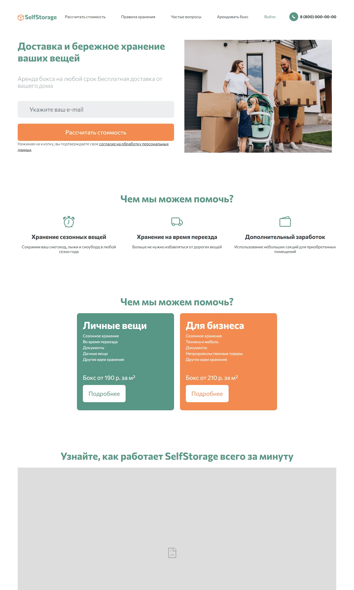
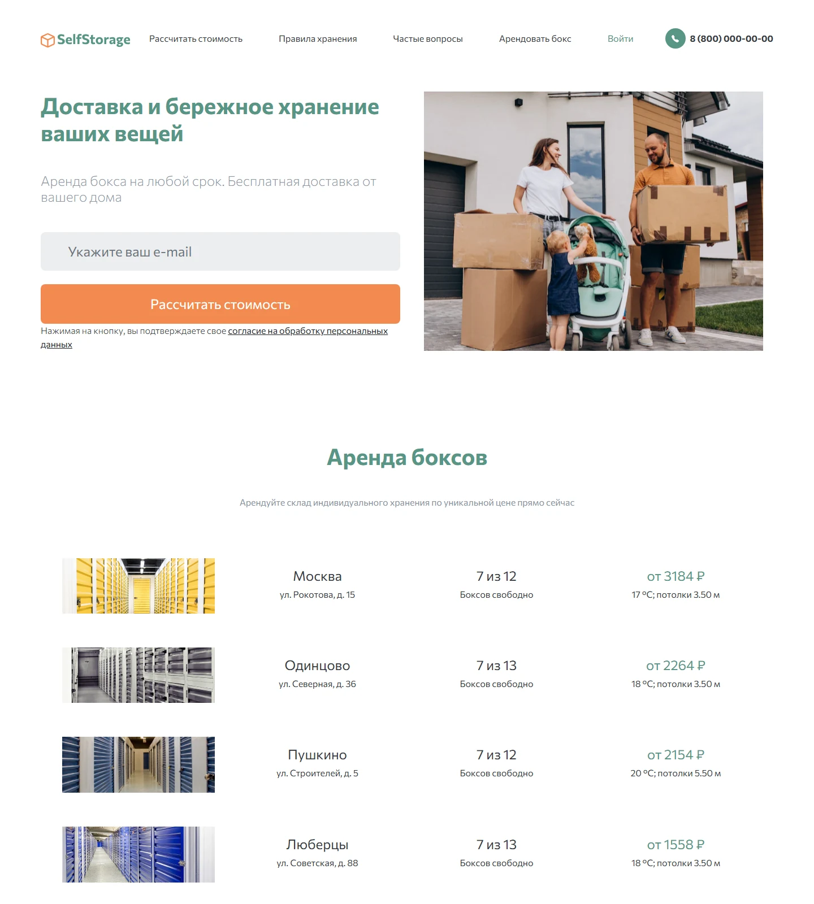
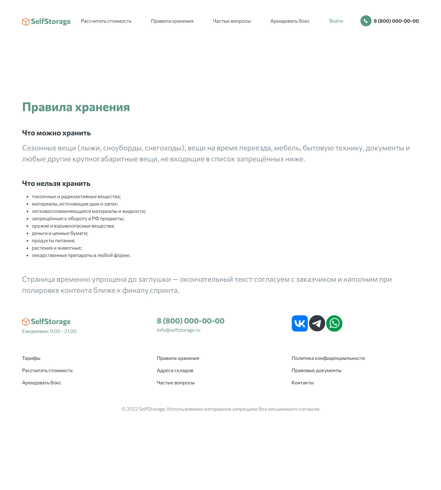
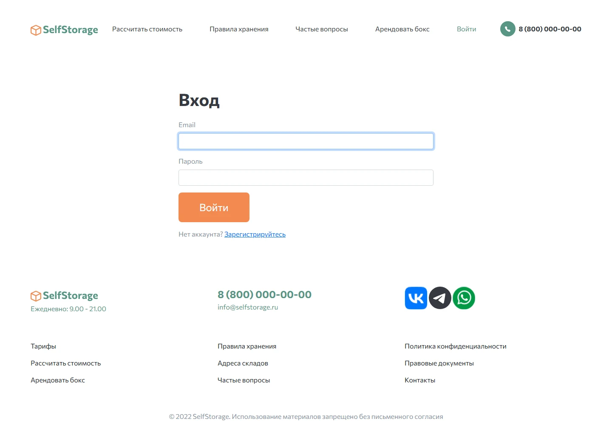
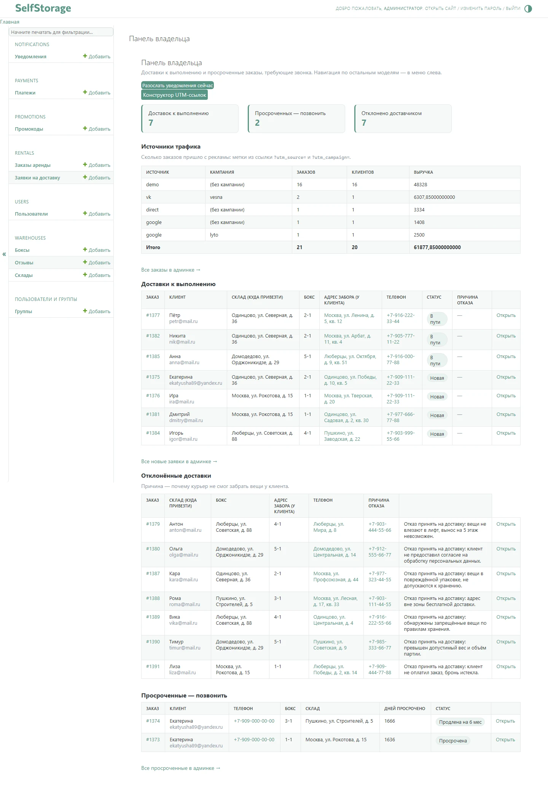
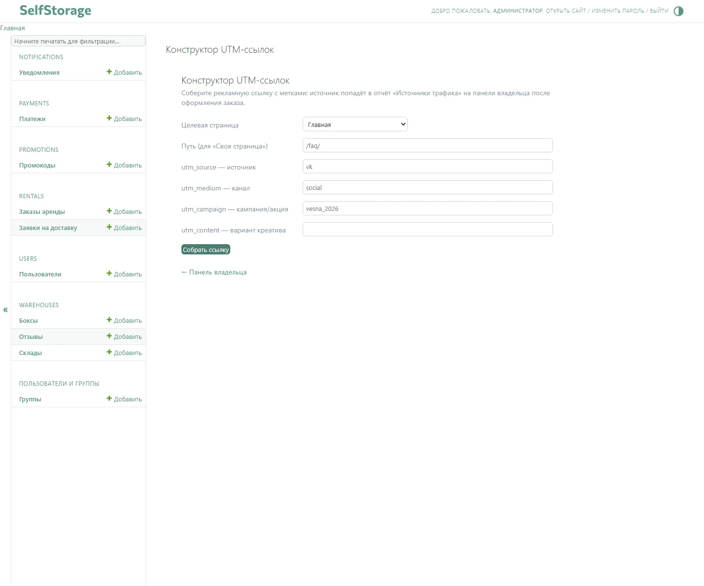

# SelfStorage

Сервис аренды складских боксов: клиент выбирает склад и бокс, оформляет аренду онлайн, оплачивает через ЮKassa и получает QR-код для доступа к боксу.


[](https://github.com/skislyakow/SelfStorage/actions/workflows/ci.yml)


**Демо-стенд:** [selfstorage.kislyakov.pro](https://selfstorage.kislyakov.pro)

## Возможности

**Клиент**

- каталог из 5 складов и боксы разной площади с фильтром по размеру;
- оформление аренды визардом из нескольких шагов с серверной валидацией каждого шага;
- промокоды со сроком действия и расчёт стоимости аренды;
- оплата через ЮKassa: редирект на оплату, возврат по `return_url` и webhook о смене статуса;
- QR-код для открытия бокса, личный кабинет с активными арендами и историей платежей;
- профиль в кабинете: смена имени и загрузка аватара;
- **уведомления в кабинете** (колокольчик со счётчиком непрочитанных, список уведомлений);
- отзывы о сервисе: форма с фото на главной, публикация после модерации;
- письма: приветственное, «оплата получена», напоминания об окончании аренды (за 30/14/7/3 дня) и о просрочке;
- регистрация, вход и восстановление пароля — и в модальных окнах, и на отдельных страницах.

**Владелец и администратор**

- кастомный дашборд владельца: занятость боксов, заказы, выручка, заявки на доставку, источники трафика и рекламные кампании, ссылки на адреса в Яндекс.Картах;
- конструктор UTM-ссылок в админке: `utm_source`, `utm_medium`, `utm_campaign` собираются в готовую рекламную ссылку;
- управление складами, боксами, заказами, промокодами и платежами в Django Admin в фирменной теме;
- модерация отзывов: публикация и снятие с публикации;
- ручной запуск рассылки уведомлений из админки.

## Стек технологий

| Слой | Технологии |
|---|---|
| Backend | Python 3.12, Django 5.2.17 — кастомная модель пользователя, class-based views, ORM и миграции, Django Admin, signals, middleware, management-команды |
| Данные | SQLite (осознанный выбор для демо-стенда: база — один файл, отдельный сервер БД не нужен) |
| Фронтенд | Django Templates, Bootstrap 5.0.2, собственный CSS, vanilla JS |
| Оформление заказа | django-formtools (`SessionWizardView`), валидация через Django Forms |
| Платежи | API ЮKassa: создание платежа, `return_url`, webhook |
| Почта и уведомления | Django email backend, SMTP REG.RU, management-команда `send_notifications`, systemd timer |
| QR-доступ | `qrcode` + Pillow |
| Конфигурация | django-environ, 12-факторный `.env` (шаблон — `.env.example`) |
| Продакшен | nginx 1.24 + gunicorn под systemd на VPS (Ubuntu); приложение и таймер уведомлений — отдельные юниты |
| CI/CD | GitHub Actions: CI (lint, типы, тесты, проверка миграций) и деплой на сервер по SSH |
| Качество кода | uv (зависимости и Python), ruff (lint и формат), mypy + django-stubs, pre-commit, Django TestCase |

## Скриншоты













## Как запустить

```powershell
# 1. Клонируем репозиторий
cd SelfStorage

# 2. Создаём окружение: зависимости uv и git-хуки pre-commit
./scripts/bootstrap.ps1

# 3. Создаём и заполняем .env (локальный запуск)
Copy-Item .env.example .env

# 4. Применяем миграции
uv run python manage.py migrate

# 5. Заполняем демо-данными
uv run python manage.py seed_demo

# 6. Запускаем сервер
uv run python manage.py runserver
```

## Демо-доступы

Появляются после `seed_demo`:

| Роль | E-mail | Пароль |
|---|---|---|
| Администратор (`/admin/`) | `admin@selfstorage.ru` | `admin12345` |
| Пользователь (кабинет Екатерины, `my-rent`) | `ekatyusha89@yandex.ru` | `111111111` |

## Проверки

```powershell
# тесты (SECRET_KEY обязателен: настройки читают его через django-environ)
$env:SECRET_KEY="test-key"; uv run python manage.py test

# линтер и формат
uv run ruff check .
uv run ruff format --check .

# типы
uv run mypy .

# всё сразу — те же хуки, что и в pre-commit
uv run pre-commit run --all-files
```

## Структура проекта

```
apps/        Django-приложения: users, warehouses, rentals, promotions, payments, notifications
config/      настройки, роутинг, базовые шаблоны, дашборд владельца и конструктор UTM-ссылок
docs/        деплой, UTM-метки, QR-доступ, уведомления
scripts/     bootstrap окружения (PowerShell и sh)
static/      исходные CSS и изображения
deploy.sh    шаги деплоя на сервере
```

## Документация

- [docs/TODO.md](docs/TODO.md) — открытые задачи проекта (что осталось сделать)
- [CONVENTIONS.md](CONVENTIONS.md) — договорённости проекта (URL, сигналы, переменные шаблонов)
- [AGENTS.md](AGENTS.md) — окружение, команды и правила работы агентов в этом репозитории
- [docs/deployment.md](docs/deployment.md) — деплой, переменные окружения
- [docs/utm.md](docs/utm.md) — UTM-метки и источники трафика
- [docs/qr-access.md](docs/qr-access.md) — QR-доступ и статус бокса
- [docs/notifications.md](docs/notifications.md) — напоминания и просрочки (systemd)

## Лицензия

MIT
